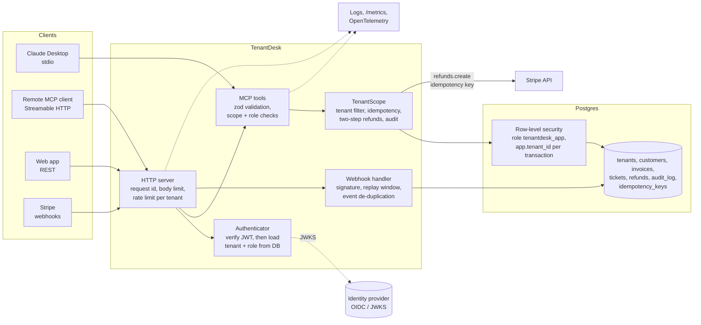

# TenantDesk MCP

An enterprise-grade, tenant-safe [MCP](https://modelcontextprotocol.io) server for a multi-tenant SaaS.
Claude (or any MCP client) can look up customers, search invoices, open support tickets and refund payments through Stripe, **but only inside the signed-in user's own workspace, with that user's role, and only as far as their OAuth token allows.**

Most MCP servers you find online pass a `tenant_id` or `user_id` in the tool arguments. That means the AI decides whose data it reads, and one prompt injection is enough to read another customer's data. TenantDesk does it the other way round, and backs it with the controls an enterprise security review asks for.

## At a glance

| Area | What's in place |
|---|---|
| **Identity** | OAuth 2.1 / OIDC bearer tokens verified against your identity provider's JWKS (issuer, audience, expiry, signature). Protected resource metadata (RFC 9728) so MCP clients can discover the authorization server. |
| **Least privilege for agents** | OAuth scopes (`tenantdesk:read`, `:write`, `:refunds`, `:audit`) limit the agent *below* the user's role. An admin can give Claude a read-only token. |
| **Tenant isolation, layer 1** | Tools take no tenant or user id. Every query goes through one `TenantScope` that filters on the caller's tenant. |
| **Tenant isolation, layer 2** | Postgres **row-level security**. Queries run as a restricted role with the tenant set per transaction, so a missed filter still can't return another tenant's rows, and no tenant means no rows. |
| **Money movement** | Two-step refunds (request, then confirm by the same admin within 10 min, capped at $500), executed through **Stripe with idempotency keys**. If Stripe fails, the balance reservation rolls back and the request can be retried safely. |
| **Safe retries** | Write tools accept an `idempotency_key`. Retries return the first result; reusing a key for a different request is refused. Verified with 10 concurrent retries on real Postgres. |
| **Audit** | Every tool call, allowed or denied, is written to an append-only audit log (the app role can't update or delete it), with the request id. Admins export it as NDJSON for a SIEM. |
| **Abuse protection** | Per-tenant rate limits (429 + `Retry-After`), request body limits, request timeouts. |
| **Observability** | Structured JSON logs (tokens redacted), Prometheus metrics at `/metrics`, OpenTelemetry traces per tool call (tool, tenant, outcome). |
| **Operations** | Health and readiness probes, graceful shutdown, migrations with an advisory lock, config validated at startup (refuses dev auth, demo data or default secrets in production). |
| **Delivery** | Multi-stage Docker image running as non-root, Docker Compose with Postgres 16 and optional Jaeger. |

## Architecture



## Tools

| Tool | Role | Scope | Type |
|---|---|---|---|
| `list_customers` | any | `tenantdesk:read` | read |
| `get_customer` | any | `tenantdesk:read` | read |
| `search_invoices` | any | `tenantdesk:read` | read |
| `get_ticket_history` | any | `tenantdesk:read` | read |
| `create_ticket` | admin, agent | `tenantdesk:write` | write, idempotent with a key |
| `request_refund` | admin | `tenantdesk:refunds` | write (step 1 of 2), idempotent with a key |
| `confirm_refund` | the admin who requested it | `tenantdesk:refunds` | destructive (step 2 of 2), calls Stripe |

Read tools are marked `readOnlyHint`, and `confirm_refund` is marked `destructiveHint`, so MCP clients can ask the user before running it.

## HTTP endpoints

| Endpoint | Purpose |
|---|---|
| `POST /mcp` | MCP over Streamable HTTP, stateless, bearer token on every request |
| `GET /.well-known/oauth-protected-resource` | OAuth protected resource metadata (RFC 9728) |
| `GET /api/customers/export` | CSV export (admin, agent), formula-injection safe |
| `GET /api/invoices/:id` | One invoice, tenant-scoped |
| `GET /api/audit-log?from=&to=` | Audit trail as NDJSON (admin + `tenantdesk:audit`) |
| `POST /webhooks/stripe` | Signed, 5-minute replay window, each event applied once, secret rotation supported |
| `GET /healthz`, `/readyz`, `/metrics` | Liveness, readiness (database ping), Prometheus metrics |

## Run it

Requires Node.js 20+ (22 recommended).

```bash
npm install
npm test               # 30 tests on in-memory Postgres (PGlite)
npm run test:postgres  # 3 more against a real Postgres (set TEST_DATABASE_URL)
npm run poc            # security regression checks: 0 of 10 vulnerable
```

### Full stack with Docker

```bash
docker compose up --build                      # Postgres 16 + TenantDesk on :3333
docker compose --profile tracing up --build    # plus Jaeger UI on :16686
```

With tracing, set `OTEL_EXPORTER_OTLP_ENDPOINT=http://jaeger:4318` for the app.

Demo data has two clinics:

| User | Tenant | Role |
|---|---|---|
| `u_ana` | Acme Dental | admin |
| `u_ben` | Acme Dental | agent |
| `u_cara` | Acme Dental | viewer |
| `u_dev` | Brightside Clinic | admin |
| `u_eli` | Brightside Clinic | agent |

### With Claude Desktop (stdio)

```bash
npm run token u_ana                     # all scopes
npm run token u_ana tenantdesk:read     # same admin, read-only token for the agent
```

Add to `claude_desktop_config.json`:

```json
{
  "mcpServers": {
    "tenantdesk": {
      "command": "npx",
      "args": ["tsx", "/absolute/path/to/tenantdesk-mcp/src/stdio.ts"],
      "env": { "TENANTDESK_TOKEN": "<token from the command above>" }
    }
  }
}
```

Then ask Claude things like *"Which Acme customers have open invoices?"* or *"Refund $20 on invoice inv_a1, the customer was charged twice."*

### With your identity provider (production)

```bash
NODE_ENV=production
AUTH_MODE=oidc
OIDC_ISSUER=https://your-tenant.us.auth0.com/
OIDC_AUDIENCE=https://mcp.example.com/mcp
DATABASE_URL=postgres://...
STRIPE_SECRET_KEY=sk_live_...
STRIPE_WEBHOOK_SECRET=whsec_...
SEED_DEMO=false
```

Users are matched by the token's `sub` to `users.external_sub`. Tenant and role always come from the database, never from token claims, so a downgraded or removed user loses access on their next call. See [`.env.example`](.env.example) for every setting.

## Security assessment

[`assessment/report/TenantDesk-Security-Assessment-Report.pdf`](assessment/report/TenantDesk-Security-Assessment-Report.pdf) is a full sample report: scope, method, 10 findings with CVSS scores, reproduction steps, fixes and retest.
The assessed build is tag [`v0.1.0`](../../tree/v0.1.0) (deliberately vulnerable). Run the PoC script on every change (`npm run poc`), so none of the 10 findings can come back unnoticed.

```bash
git checkout v0.1.0 && npx tsx assessment/poc.ts   # 10 of 10 vulnerable
git checkout main   && npm run poc                 # 0 of 10 vulnerable
```

## Tests

`npm test` connects a real MCP client to the server. Among others it checks:

- An Acme user only ever sees Acme customers; passing `tenant_id` does nothing; "not found" is identical for other tenants' ids and made-up ids.
- Row-level security alone keeps tenants apart, and returns nothing when no tenant is set.
- The application role can't update or delete audit log entries.
- A read-only token can't write or refund, even for an admin.
- A user downgraded to viewer loses write access on the next call with the same token.
- OIDC tokens with the wrong audience, wrong issuer, an expired `exp` or a foreign signing key are rejected.
- Retried writes with an idempotency key create nothing new; reusing a key for different input is refused.
- Refunds reach the payment provider once, keyed by the confirmation id; a provider failure rolls back and can be retried.
- 429 with `Retry-After` after the tenant's budget is used, without affecting other tenants.
- Stripe webhooks: bad and stale signatures rejected, rotated secrets accepted.
- Production config refuses dev auth, demo data and default secrets.

On real Postgres (`npm run test:postgres`): migrations are re-runnable, 10 concurrent retries with one idempotency key create exactly one ticket, and two admins racing to over-refund the same invoice can't exceed its balance.

## Project layout

```
src/config.ts         environment schema, validated at startup
src/db.ts             Postgres (node-postgres pool) or PGlite, migrations with advisory lock
src/migrations.ts     schema, row-level security policies, demo seed
src/auth.ts           OIDC/JWKS and dev token verification, scopes -> Principal
src/repo.ts           TenantScope: the only data path (tenant filter + RLS, idempotency, refunds, audit)
src/payments.ts       Stripe refunds with idempotency keys; in-memory fake for demo and tests
src/server.ts         MCP tool definitions, validation, error handling, audit, metrics, spans
src/http.ts           HTTP server: MCP, REST, webhooks, OAuth metadata, health, metrics, shutdown
src/api.ts            REST endpoints and the Stripe webhook
src/ratelimit.ts      per-tenant token bucket
src/observability.ts  pino logger, Prometheus metrics, OpenTelemetry setup
src/stdio.ts          local transport (Claude Desktop, MCP Inspector)
test/                 end-to-end tests through a real MCP client
assessment/           security report, PoC checks, results
```

## Scaling notes

- The server is stateless, so run as many replicas as you need behind a load balancer.
- The included rate limiter is in-memory, which suits one instance. For several replicas, implement the `RateLimiter` interface on Redis so the budget is shared.
- Run `npm run migrate` as a release step, or let instances migrate on start (an advisory lock prevents races).

## License

MIT. Built by Azeem Haider.
